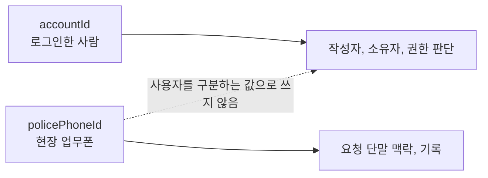

# [BE] 현장 기록 API에서 policePhoneId가 사용자 식별자처럼 쓰이는 문제

## 문제 배경

이번 이슈는 현장 기록 API에서 `policePhoneId`가 사용자를 구분하는 값처럼 쓰이던 흐름을 정리한 작업이다.

문제는 실기기 테스트 중에 발견했다. 테스트 계정 두 개는 서로 다른 `accountId`를 가지고 있었지만 같은 `policePhoneId`를 사용하고 있었다. 두 계정이 동시에 수색 시작 버튼을 눌러 지도 위에 경로를 남기자, 서버와 화면에서는 두 사람의 기록이 한 사람의 기록처럼 섞여 보였다. 지도에는 경로가 지그재그로 이어졌고, 마커도 누가 남긴 정보인지 구분하기 어려웠다.

수리맵에서 사람을 나타내는 값은 `accountId`이고, 현장에서 쓰는 업무폰을 나타내는 값은 `policePhoneId`다.



업무폰은 사람이 아니다. 같은 사람이 다른 업무폰을 쓸 수도 있고, 서로 다른 사람이 같은 업무폰을 이어서 쓸 수도 있다. 그래서 현장 기록의 작성자나 소유자를 판단할 때 `policePhoneId`를 사용하면, 실제 사람 기준의 기록이 뒤섞일 수 있다.

이 문제를 그대로 두면 수색 경로, GPS 적재, 마커 작성자, 근무교대 종료 요청자가 잘못 묶일 수 있다. 현장 기록은 나중에 인수인계와 상황판 확인에 다시 쓰이기 때문에, 누가 남긴 기록인지 정확히 구분되어야 한다.

## 원인 분석과 선택지

원인은 일부 현장 기록 API에서 `policePhoneId`를 요청자 판단에 함께 사용하던 흐름이었다. 업무폰 값이 작성자나 종료 요청자를 보조하는 조건으로 들어가면, 같은 사람이 다른 업무폰으로 요청했을 때는 막히고 다른 사람이 같은 업무폰으로 요청했을 때는 같은 사람처럼 보일 수 있다.

검토한 선택지는 두 가지였다.

1. `accountId`와 `policePhoneId`를 함께 묶어서 판단

   같은 사람과 같은 업무폰이라는 조건을 강하게 확인할 수 있다. 하지만 인사 발령, 단말 교체, 업무폰 공유처럼 사람이 같은데 업무폰이 달라지는 상황을 설명하기 어렵다. 반대로 같은 업무폰을 다른 사람이 쓰는 경우에는 사람을 잘못 묶을 위험이 남는다.

2. 사용자 판단은 `accountId`로 고정하고, `policePhoneId`는 업무폰 맥락으로만 유지

   작성자, 소유자, 종료 요청자는 로그인 계정인 `accountId`로 판단한다. `policePhoneId`는 어떤 업무폰에서 들어온 요청인지 남기거나 오프라인 패키지 같은 단말 맥락을 확인할 때만 사용한다.

수리맵의 인증과 사건 배정은 계정 기준으로 판단해야 한다. 그래서 두 번째 선택지를 택했다.

## 변경 내용과 트레이드오프

현장 기록 API에서 `policePhoneId`를 사용자 식별자처럼 쓰던 처리를 제거했다.

- 수색 시작, 수색 종료, GPS 적재에서 작성자와 소유자 판단을 `accountId` 기준으로 변경
- 마커 생성, 수정, 삭제 guard에서 사건 배정과 작성자 판단을 `accountId` 기준으로 변경
- 마커 사진 attach 흐름에서 작성자 판단을 `accountId` 기준으로 변경
- 수색 구역 알림 생성 흐름에서 계정 기준 요청 검증으로 변경
- 근무교대 종료 흐름에서 기존 업무폰과 요청 업무폰을 비교하던 조건 제거
- `policePhoneId`가 필요한 응답 필드와 기록 맥락은 유지

트레이드오프는 업무폰 일치 여부로 막던 일부 요청을 더 이상 차단하지 않는다는 점이다. 대신 권한 판단의 기준을 사건에 배정된 계정으로 고정했다. 업무폰 값은 기록과 단말 맥락에서는 유지하지만, 사람을 구분하는 조건으로는 사용하지 않는다.

## 검증 결과

로컬 통합 테스트와 배포 서버 smoke test로 근무교대 종료, 마커 생성, 계정 기준 요청 검증 흐름을 확인했다.

로컬 테스트에서는 다음 케이스를 확인했다.

- `S8HandoverApiContractTest.appEndsOwnDutyShiftFromAnotherRegisteredPolicePhone`: 같은 계정이 다른 등록 업무폰으로 근무교대 종료 요청을 보내면 성공
- `S8HandoverApiContractTest.appCannotEndAnotherAccountsDutyShiftFromMatchingPolicePhone`: 다른 계정이 같은 업무폰으로 근무교대 종료 요청을 보내면 `write_conflict`로 거부
- `MarkerCreateRuntimeGuardIntegrationTest.assignedAccountCanCreateMarkerFromAnotherRegisteredPhone`: 사건에 배정된 계정이면 다른 등록 업무폰에서도 마커 생성 허용

백엔드 전체 테스트도 실행했다.

```bash
cd backend
./gradlew test --rerun-tasks
```

결과는 `BUILD SUCCESSFUL`이었다. XML 리포트 합산 기준 `tests=1055`, `failures=0`, `errors=0`, `skipped=0`이었다.

배포 서버에서는 실제 Keycloak 토큰, mock-112 시나리오, PostGIS 데이터, API 호출로 근무교대 종료 흐름을 확인했다. 같은 계정이 기존 근무교대 시작 업무폰과 다른 업무폰으로 종료 요청을 보냈고, DB에는 종료 요청 계정이 `ended_by_account_id`로 기록됐다.

사용한 데이터는 다음과 같다.

- mock-112 시나리오: `precinct-first`
- 사건 id: `aaaaaaaa-aaaa-aaaa-aaaa-aaaaaaaa0001`
- 활성 수색 차수 id: `88888888-8888-8888-8888-888888880001`
- 요청 계정: `acct-precinct-team`
- 요청 계정의 `accountId`: `11111111-1111-1111-1111-111111110003`
- 근무교대 시작 업무폰: `00000000-0000-0000-0000-000000000101`
- 근무교대 종료 요청 업무폰: `50000000-0000-0000-0000-000000000001`

확인한 DB 행은 다음과 같다.

```text
status=ENDED
started_by_account_id=11111111-1111-1111-1111-111111110003
ended_by_account_id=11111111-1111-1111-1111-111111110003
police_phone_id=00000000-0000-0000-0000-000000000101
version=2
```

이 smoke test는 근무교대 종료 API를 대상으로 한 확인이다. 수정 후 실기기에서 두 계정이 같은 `policePhoneId`로 동시에 수색을 시작하는 시나리오를 다시 촬영하거나 재현한 기록은 아직 없다. 필요하면 별도 실기기 smoke test로 보강한다.
