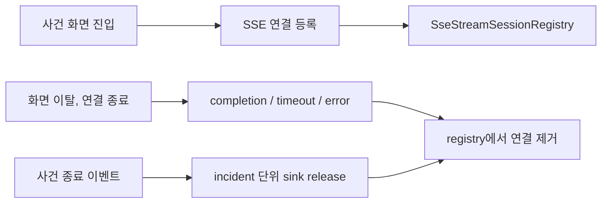

# [BE] SSE 연결 해제 후 세션 잔존 여부가 검증되지 않은 문제

# 본문

## 문제 배경

수리맵은 SSE 연결을 오래 유지하면서 지도 변경 알림을 보낸다. 사용자가 사건 화면을 열면 서버는 해당 사건의 SSE 연결을 `SseStreamSessionRegistry`에 등록한다. 사용자가 화면을 나가거나 네트워크가 끊기면, 서버는 그 연결을 registry에서 제거해야 한다.

이 정리가 빠지면 이미 끊긴 연결이 registry에 남는다. 그러면 사건 변경 이벤트가 생길 때마다 서버가 더 이상 살아 있지 않은 연결에도 이벤트를 보내려고 시도한다. 이런 연결이 계속 쌓이면 불필요한 전송 시도와 메모리 사용이 늘어날 수 있다.

이번 이슈는 heap dump로 메모리 누수를 증명하는 작업이 아니다. 메모리 누수로 이어질 수 있는 SSE 연결 잔존 지점을 테스트로 확인하는 작업이다.



## 원인 분석과 선택지

`SseStreamService`는 사건별 SSE 연결을 열 때 sink를 registry에 등록한다. 이 연결은 일반 요청처럼 바로 끝나지 않기 때문에, completion, timeout, error 같은 종료 callback에서 등록을 해제해야 한다. 사건이 종료될 때도 해당 사건의 sink가 함께 release되어야 한다.

검토한 선택지는 두 가지였다.

1. 로그와 수동 확인만 남기기

   구현은 빠르지만 같은 문제가 다시 생겼을 때 자동으로 잡아내기 어렵다. 연결 생명주기는 회귀가 생기기 쉬운 부분이므로 테스트로 남기는 편이 낫다.

2. registry 단위 테스트와 사건 종료 흐름 테스트로 확인하기

   실제 heap dump까지 다루지는 않지만, 연결이 남는지 여부를 작고 반복 가능한 테스트로 확인할 수 있다. 이번 이슈의 목적에는 이 선택지가 더 적합하다.

그래서 등록과 해제를 100회 반복하는 테스트를 추가하고, 기존 사건 종료 이벤트 테스트와 함께 실행해 incident sink가 release되는 흐름을 확인했다.

## 변경 내용과 트레이드오프

`SseStreamLifecycleEvidenceTest`를 추가해 incident sink 등록과 해제를 100회 반복했다. 각 반복에서 `SseStreamSessionRegistry.sinks(incidentId)`가 등록 후 1개가 되고, close 후 비어 있는지 확인했다.

기존 `SseIncidentClosureReplayStopTest`도 함께 실행했다. 이 테스트는 사건 종료 이벤트 이후 해당 incident의 sink가 release되는 흐름을 확인한다.

트레이드오프는 이 검증이 실제 운영 메모리 사용량이나 heap dump를 확인하지 않는다는 점이다. 대신 SSE 연결이 registry에 남는지 여부를 빠르고 반복 가능한 테스트로 확인할 수 있다.

## 검증 결과

다음 명령을 실행했다.

```bash
cd backend
./gradlew test --tests com.surimap.eventhub.SseStreamLifecycleEvidenceTest
./gradlew test --tests com.surimap.eventhub.SseStreamLifecycleEvidenceTest --tests com.surimap.eventhub.SseIncidentClosureReplayStopTest
./gradlew test --rerun-tasks
```

세 명령 모두 `BUILD SUCCESSFUL`이었다.

확인한 내용은 다음과 같다.

- SSE 연결 등록과 해제를 100회 반복해도 `SseStreamSessionRegistry.sinks(incidentId)`가 비어 있음
- 사건 종료 이벤트 이후 incident sink가 release됨
- 백엔드 전체 테스트가 통과함

이번 검증은 테스트 환경 기준이다. 운영 환경의 실제 메모리 사용량, 장시간 연결 유지 상황, heap dump는 확인하지 않았다.

# 댓글

## 추가 검증 기록

`SseStreamLifecycleEvidenceTest`를 추가해 incident sink 등록과 해제를 100회 반복했다. 각 반복에서 `SseStreamSessionRegistry.sinks(incidentId)`가 등록 후 1개가 되고, close 후 비어 있는지 확인했다.

기존 `SseIncidentClosureReplayStopTest`도 함께 실행했다. 이 테스트는 사건 종료 이벤트 이후 해당 incident의 sink가 release되는 흐름을 확인한다.

실행한 명령은 다음과 같다.

```bash
cd backend
./gradlew test --tests com.surimap.eventhub.SseStreamLifecycleEvidenceTest
./gradlew test --tests com.surimap.eventhub.SseStreamLifecycleEvidenceTest --tests com.surimap.eventhub.SseIncidentClosureReplayStopTest
./gradlew test --rerun-tasks
```

세 명령 모두 `BUILD SUCCESSFUL`이었다.

이번 검증은 SSE 연결이 registry에 남는지 확인한 테스트 환경 기준이다. 운영 환경의 실제 메모리 사용량, 장시간 연결 유지 상황, heap dump는 확인하지 않았다.
